# 16-825 Assignment 3

**AndrewId**: sbandred

**Name:** Sri Datta Bandreddi

# A. Neural Volume Rendering

## 1.3 Ray sampling

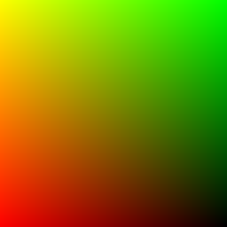 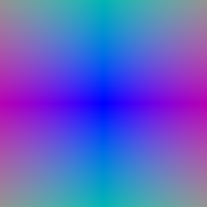

## 1.4 Point sampling

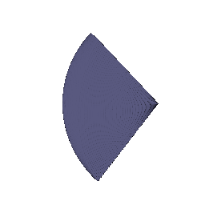

## 1.5 Volume rendering

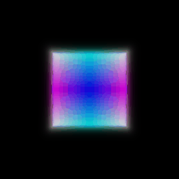 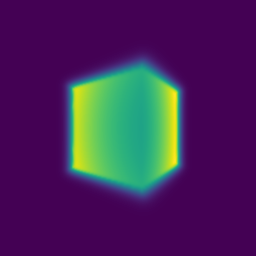

## 2. Optimizing a basic implicit volume

| | x | y | z |
|---|---|---|---|
| Box center | 0.25 | 0.25 | 0.00 |
| Box side lengths | 2.01 | 1.50 | 1.50 |

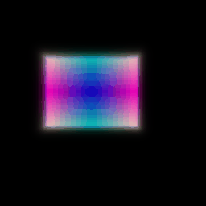

## 3. Optimizing a Neural Radiance Field

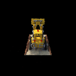

## 4.1 View dependence

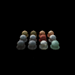

**Trade-off.** With more view dependence the network can explain each training image by changing color with direction instead of getting the shape right. It fits the training views well but gives wrong colors and floaters in new views. Keeping density independent of direction, using only 2 direction frequencies, and a small color head limit this.

## 4.2 Coarse and fine sampling

Part 3 on the left, coarse and fine on the right.

 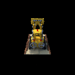

| | Points per ray | Time per training step | Test PSNR (200 views) |
|---|---|---|---|
| Part 3 | 128 | 7.0 ms | 24.01 |
| Coarse and fine | 64 + 192 | 12.0 ms (1.7x) | **24.50** |

**Trade-off.** Coarse and fine is more accurate because more points land near the surface instead of in empty space. It costs more per step since it evaluates two networks on 256 points per ray instead of one network on 128.

## 4.3 VolSDF

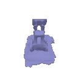 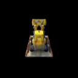

**alpha and beta.** Alpha is the density inside the object. Beta is how quickly density goes from alpha to 0 across the surface.

**1. High vs low beta.** High beta spreads density over a thick shell, so the surface is blurry and the learned distance is smoothed out. Low beta makes the density close to a step, which is close to a hard surface.

**2. Easier to train.** High beta. Density and its gradient are nonzero over a wide band, so many points on each ray get a training signal. With low beta only points very close to the surface get any gradient.

**3. More accurate surface.** Low beta. The rendered color then comes from a thin shell at distance 0, so the surface has to be in the right place.

**Settings.** Alpha 10, beta 0.05, eikonal weight 0.02, 250 epochs. Beta 0.05 is small enough for a sharp surface but still gives gradients early on. The distance network starts as a sphere of radius 1. Without that it started negative everywhere and no surface came out.

# B. 3D Gaussian Splatting

## 5. 3D Gaussian rasterization

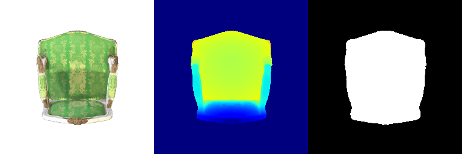

## 6. Training 3D Gaussian representations

| Parameter | Learning rate |
|---|---|
| Opacities | 0.01 |
| Scales | 0.005 |
| Colors | 0.01 |
| Means | 0.0005 |

| Iterations | PSNR | SSIM |
|---|---|---|
| 1000 | 29.56 | 0.940 |

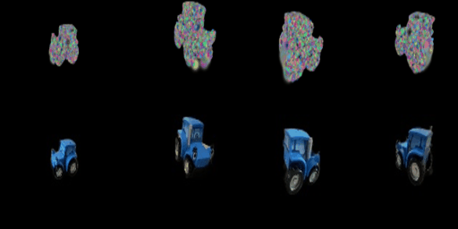

## 7.1 Rendering using spherical harmonics

Without spherical harmonics (5) on the left, with them on the right.

 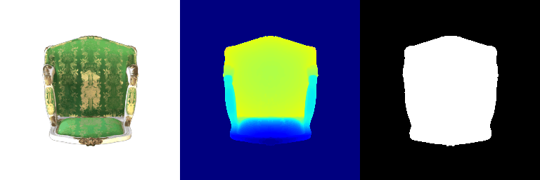

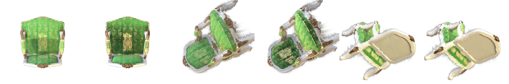

- **Front of the chair.** The fabric is darker green with a sharper gold pattern. Without spherical harmonics it is a flat, washed-out green, because the first coefficient is only the average color over all directions.
- **Top of the seat.** The cushion looks shiny, with bright and dark patches that depend on the view. Without spherical harmonics it is evenly lit.
- **Underside.** Almost the same. The wood and beige cloth are matte, so their color barely changes with direction.

## 7.2 Training on a harder scene

| Method | Iterations | PSNR | SSIM |
|---|---|---|---|
| Baseline (Q6 setup) | 1000 | 18.29 | 0.653 |
| Improved | 2000 | **24.24** | **0.890** |

**Baseline**

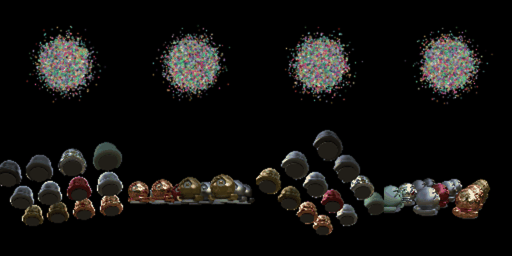

**Improved**

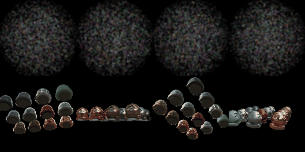

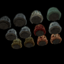

| Parameter | Learning rate (improved) |
|---|---|
| Opacities | 0.05 |
| Scales | 0.005 |
| Colors | 0.01 |
| Rotations | 0.001 |
| Means | 1.6e-3 decaying to 1.6e-5 |

Modifications
- **Initialization.** Points spread evenly in a ball of radius 1.3 instead of `randn * 0.2`, starting small (scale 0.02) and faint (opacity about 0.12).
- **Anisotropic Gaussians.** Rotations and 3 scales are trained, so Gaussians can stretch along edges and curved surfaces.
- **Loss.** `0.8 * L1 + 0.2 * (1 - SSIM)`.
- **Learning rate schedule.** Exponential decay for the means.
- **Densification and pruning.** Every 100 iterations from 5% to 60% of training, Gaussians with large position gradients are copied (if small) or split (if large), nearly transparent ones are removed, and opacities are reset once at iteration 1000. The count grows from 10k to about 27k.
- **More iterations.** 2000 instead of 1000.
