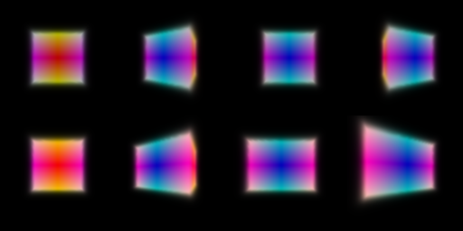

# 16-825 Assignment 3

**AndrewId**: sbandred

**Name:** Sri Datta Bandreddi

# A. Neural Volume Rendering

## 1.3 Ray sampling
Make a grid of pixels in [-1, 1] and shoot one ray from the camera through each pixel.

 

## 1.4 Point sampling
Place 64 evenly spaced points on each ray between the near and far planes. Points from the first camera are shown.


## 1.5 Volume rendering
Each point gets a weight `T * (1 - exp(-density * length))`, where `T` is how much light gets through all the points before it. Color and depth are the weighted sums along the ray. Depth is divided by its largest value.

 

## 2. Optimizing a basic implicit volume
Pick 4096 random pixels per step and fit the box with mean squared error against the 4 training images.

Top row is before training, bottom row is after.



| | x | y | z |
|---|---|---|---|
| Box center | 0.25 | 0.25 | 0.00 |
| Box side lengths | 2.01 | 1.50 | 1.50 |


## 3. Optimizing a Neural Radiance Field
The point is encoded with 6 sine and cosine frequencies and passed through an MLP.
```
encoded point (39)
6 Linear layers, 128 wide, ReLU, point fed in again at layer 3
density  Linear 128->1, ReLU
color    Linear 128->64, ReLU, Linear 64->3, Sigmoid
```
Mean squared error, 1024 rays per step, 128 points per ray, 250 epochs on 128x128 lego images.


## 4.1 View dependence (extra credit)
The ray direction (2 frequencies) is added to the input of the color layers only, so density still depends on position alone. Trained on the materials scene, 250 epochs, learning rate 1e-4. ReLU density died out on this dark scene within 10 epochs, so softplus is used for density here.


The spheres show highlights that move as the camera turns, which a position-only NeRF can't do.

**Trade-off.** With more view dependence the network can explain each training image by changing color with direction instead of getting the shape right. It fits the training views well but gives wrong colors and floaters in new views. Keeping density independent of direction, using only 2 direction frequencies, and a small color head limit this.

## 4.2 Coarse and fine sampling (extra credit)
Two networks. The coarse one is evaluated at 64 evenly spaced points. Its weights tell where the surface is, and 128 more points are drawn there. The fine network uses all 192 points. The loss is the coarse error plus the fine error.

Part 3 on the left, coarse and fine on the right.

 

The bucket and tracks are sharper, because more points land on the surface instead of in empty space. Each step costs about 2 to 3 times as much, since there are two networks and 192 points per ray instead of 128.

## 4.3 VolSDF (extra credit)
```
encoded point (39)
shared    6 Linear layers, 128 wide, ReLU
distance  Linear 128->1 (no activation)
color     Linear 128->128, ReLU, Linear 128->3, Sigmoid
```
Density is `alpha * Psi(-distance)`, where `Psi` is the Laplace CDF with scale `beta`. The eikonal loss pushes the gradient of the distance to length 1. Settings are alpha 10, beta 0.05, eikonal weight 0.02, 250 epochs. The distance network starts as a sphere of radius 1. Without that it started negative everywhere and no surface came out.

 

**alpha and beta.** Alpha is the density inside the object. Beta is how quickly density goes from alpha to 0 across the surface.

**1. High vs low beta.** High beta spreads density over a thick shell, so the surface is blurry and the learned distance is smoothed out. Low beta makes the density close to a step, which is close to a hard surface.

**2. Easier to train.** High beta. Density and its gradient are nonzero over a wide band, so many points on each ray get a training signal. With low beta only points very close to the surface get any gradient.

**3. More accurate surface.** Low beta. The rendered color then comes from a thin shell at distance 0, so the surface has to be in the right place.

# B. 3D Gaussian Splatting

## 5. 3D Gaussian rasterization
Each Gaussian is projected to a 2D Gaussian on the image. They are sorted by depth, Gaussians behind the camera are dropped, and colors are blended front to back with alpha `opacity * exp(power)`. Depth and mask use the same blending. All 4 unit tests pass.


The starter code passed the wrong transmittance from one batch of Gaussians to the next (it left out the last Gaussian of each batch), which made renders with `--gaussians_per_splat` differ by up to 9/255 from rendering all at once. This is fixed in `splat`, and the two now match.

## 6. Training 3D Gaussian representations
Isotropic Gaussians starting from the truck point cloud, L1 loss, Adam, 1000 iterations.

| Parameter | Learning rate |
|---|---|
| Opacities | 0.01 |
| Scales | 0.005 |
| Colors | 0.01 |
| Means | 0.0005 |

| PSNR | SSIM |
|---|---|
| 29.56 | 0.940 |

Training progress (top is the render, bottom is the ground truth).


Final renders.


## 7.1 Rendering using spherical harmonics
Color is computed from all 16 spherical harmonic coefficients and the direction from the camera to each Gaussian, instead of only the first one.

Without spherical harmonics (5.5) on the left, with them on the right.

 

Same frames side by side. In each pair the left is without and the right is with spherical harmonics.


- **Front of the chair.** The fabric is darker green with a sharper gold pattern. Without spherical harmonics it is a flat, washed-out green, because the first coefficient is only the average color over all directions.
- **Top of the seat.** The seat cushion looks shiny, with bright and dark patches that depend on the view, like real satin. Without spherical harmonics the cushion is evenly lit.
- **Underside.** The two look almost the same. The wood and beige cloth are matte, so their color barely changes with direction.

## 7.2 Training on a harder scene (extra credit)
The materials scene, starting from 10,000 random points.

**Baseline.** The setup from Q6 (isotropic, same learning rates, L1 loss, 1000 iterations), with points from `randn * 0.2`.


**Improved.** Top is the render, bottom is the ground truth (same for the baseline above).


| Method | Iterations | PSNR | SSIM |
|---|---|---|---|
| Baseline | 1000 | 18.29 | 0.653 |
| Improved | 2000 | **24.24** | **0.890** |

| Parameter | Learning rate (improved) |
|---|---|
| Opacities | 0.05 |
| Scales | 0.005 |
| Colors | 0.01 |
| Rotations | 0.001 |
| Means | 1.6e-3 decaying to 1.6e-5 |

Changes from Q6, and why they help.
- **Wider start.** Points are spread evenly inside a ball of radius 1.3 instead of piling up near the center. The objects are spread over about that much space, so Gaussians start near them. They start small (0.02) and faint (opacity about 0.12) so they don't hide each other early on.
- **Anisotropic Gaussians.** Rotations and 3 scales are trained, so Gaussians can stretch along edges and curved surfaces.
- **L1 plus SSIM loss.** `0.8 * L1 + 0.2 * (1 - SSIM)`. The SSIM part rewards local structure and makes the reflective spheres sharper.
- **Decaying learning rate for the means.** Big steps early move Gaussians onto the objects, and small steps later let them settle.
- **Adding and removing Gaussians.** Every 100 iterations, from 5% to 60% of training, Gaussians with large position gradients are copied (if small) or split in two (if large). Nearly transparent ones are removed, and opacities are reset every 1000 iterations so leftover blobs can be removed. The count grows from 10k to about 27k, with the new ones going where the error is highest.
- **More iterations.** 2000 instead of 1000.
