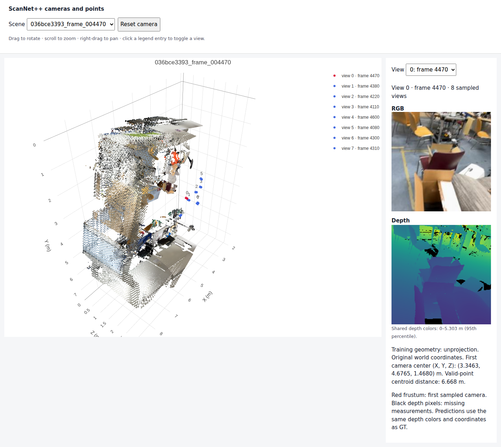
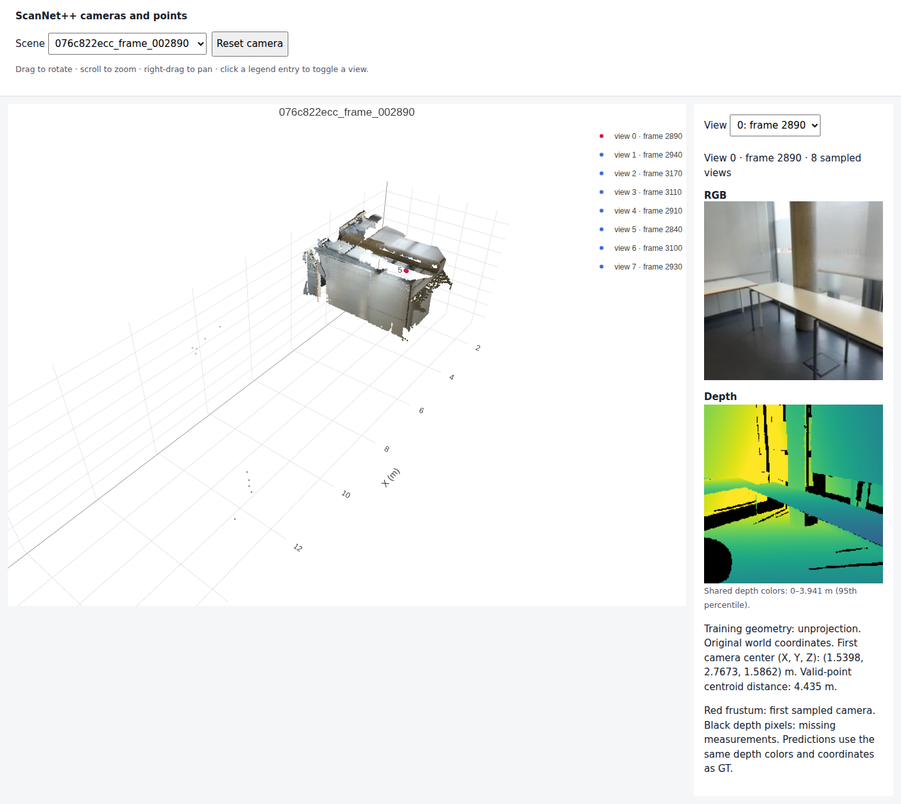
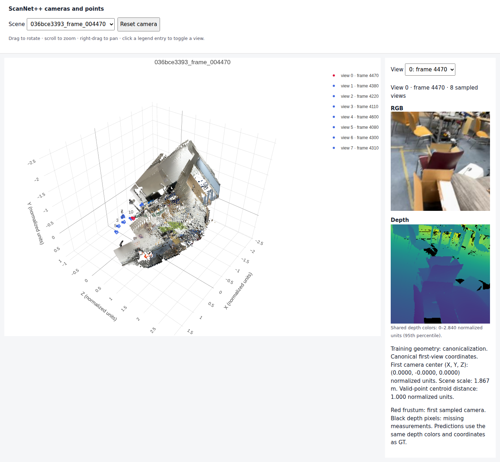
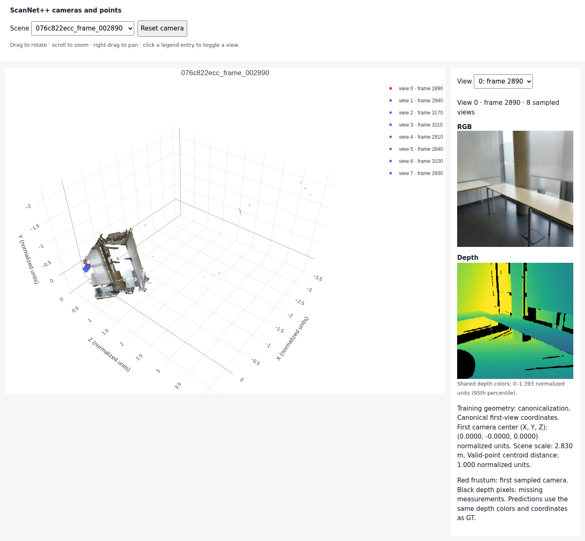
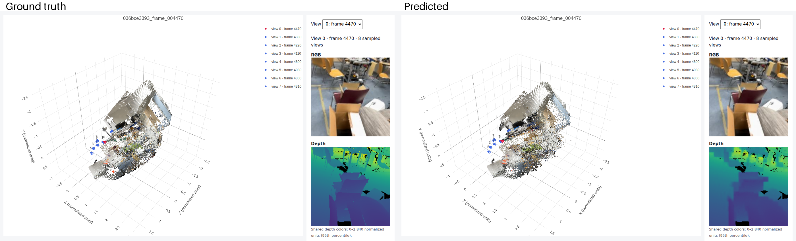
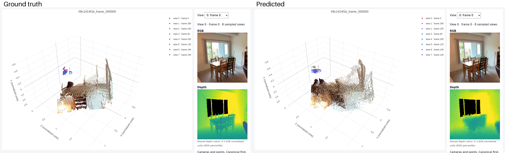
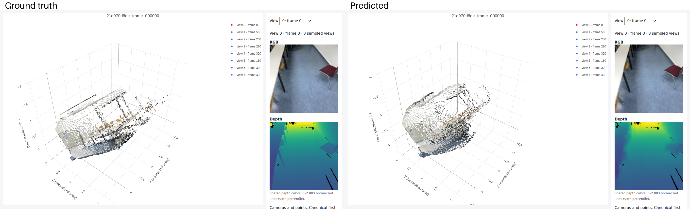
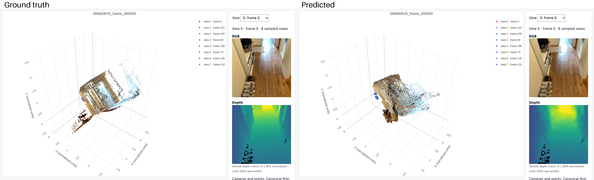
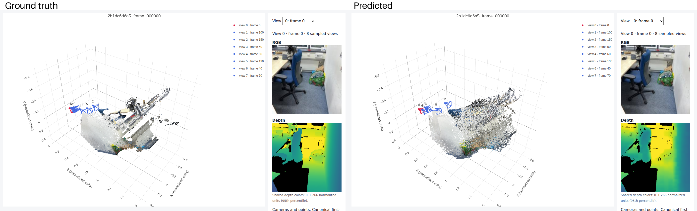

# 16-825 Assignment 4

**AndrewId**: sbandred

**Name:** Sri Datta Bandreddi

# 1. Multi-View Data Preprocessing

## Unprojection

Points and cameras in the original world frame (meters).





## Canonicalization

Same scenes after canonicalization. The panel on the right shows the first camera center (0, 0, 0) and the valid-point centroid distance (1.000).





## check_data.py

```text
{"sequence_name": "e050c15a8d_frame_007080", "views": 8, "resolution": 224, "valid_depth_fraction": 0.9779127240180969, "max_reprojection_error_px": 0.00010844774078577757, "max_ray_reprojection_error_px": 9.41436446737498e-05, "centroid_distance": 1.0}
{"sequence_name": "5f99900f09_frame_002820", "views": 8, "resolution": 224, "valid_depth_fraction": 0.9903116226196289, "max_reprojection_error_px": 0.0001220703125, "max_ray_reprojection_error_px": 0.0001078959321603179, "centroid_distance": 1.0}
{"sequence_name": "47b37eb6f9_frame_002720", "views": 8, "resolution": 224, "valid_depth_fraction": 0.9609947800636292, "max_reprojection_error_px": 9.281559323426336e-05, "max_ray_reprojection_error_px": 8.446346328128129e-05, "centroid_distance": 1.0}
{"sequence_name": "4c5c60fa76_frame_006690", "views": 8, "resolution": 224, "valid_depth_fraction": 0.7516716122627258, "max_reprojection_error_px": 0.00010504279634915292, "max_ray_reprojection_error_px": 9.423537994734943e-05, "centroid_distance": 1.0}

rgb: (2, 8, 3, 224, 224)
depth: (2, 8, 1, 224, 224)
depth_valid: (2, 8, 1, 224, 224)
K: (2, 8, 3, 3)
frame_numbers: (2, 8)
T_world_from_camera: (2, 8, 4, 4)
original_world_from_reference: (2, 4, 4)
scene_scale: (2,)
points_world: (2, 8, 3, 224, 224)
ray_origins: (2, 8, 3, 224, 224)
ray_directions: (2, 8, 3, 224, 224)
plucker: (2, 8, 6, 224, 224)
```

**Canonicalization:** All poses are expressed relative to the first sampled camera, so camera 0 becomes the identity. Translations, depth and points are then divided by the distance from camera 0 to the valid-point centroid, so every sample has the same frame and roughly the same scale.

**World-space ray directions:** Each pixel (u, v, 1) is mapped to a camera-space direction with K⁻¹, rotated into the canonical world frame with the camera rotation, and normalized. The ray origin is the camera center.

**Plücker moment:** The moment is m = o × d. Together with d it describes the ray as a line, independent of which point on the line is used as the origin, and it encodes where the ray is in space and not just which way it points.

# 2. Novel-View Synthesis with Mini-LVSM

## 2.1 Overfitting

Final overfit PSNR: 30.92 dB (2000 steps on one batch).


## 2.2 Training and evaluation

**Training settings:** Default `configs/lvsm.json`: 8 views per sample (2 sources, 6 targets), 224px, batch size 4, patch size 8, width 384, 8 blocks, head dim 64, AdamW with lr 2e-4, weight decay 0.05, 200 warmup steps and cosine decay, bf16 autocast, 100 epochs (5,600 steps) on one H100.


Validation visualization during training (epoch 95). Columns: source views, ground truth, prediction.


Validation metrics for `best.pt`:

| Source views | Conditioning | PSNR | SSIM |
|---|---|---|---|
| 1 | correct | 15.19 | 0.5579 |
| 1 | shuffled | 11.80 | 0.4871 |
| 1 | none | 12.48 | 0.5300 |
| 2 | correct | 16.13 | 0.5599 |
| 2 | shuffled | 11.50 | 0.4719 |
| 2 | none | 12.45 | 0.5276 |
| 4 | correct | 16.88 | 0.5753 |
| 4 | shuffled | 11.59 | 0.4728 |
| 4 | none | 12.47 | 0.5364 |

Evaluation visualizations (columns: source views, ground truth, prediction):

1 source view, correct rays:


2 source views, correct rays:


4 source views, correct rays:


2 source views, shuffled rays:


2 source views, no rays:


**Number of source views:** PSNR goes from 15.19 dB with 1 source to 16.13 dB with 2 and 16.88 dB with 4, although the model was only trained with 2. More sources cover more of the target view, so less of it has to be guessed.

**Ray conditioning:** With shuffled or zero target rays, PSNR drops by about 4 dB for every source count and more sources no longer help. The model really uses the target rays to decide what to render. With zero rays it outputs a flat average color of the scene, which scores a little higher than shuffled rays because shuffled rays confidently render the wrong view.

# 3. Multi-View Geometry with Mini-VGGT

## 3.1 Overfitting




## 3.2 Training and evaluation

**Training settings:** Default `configs/vggt.json`: frozen DINOv2 ViT-B/14, 8 frame/global block pairs (width 384, 6 heads), 8 views from a 32-frame window, 224px, batch size 16, AdamW with lr 6e-4, weight decay 0.01, 10 warmup epochs and cosine decay to 5% of the peak lr, loss weights camera 5 and depth 1, 1000 epochs (14,000 steps). This took about 3.8 hours on one H100 (shared with LVSM training for the first 40 minutes). `best.pt` is from epoch 788.


Metrics for `best.pt` (8 views from the first 32 prepared frames, 224px, seed 825):

| Metric | Val | Test |
|---|---|---|
| Depth AbsRel | 0.1413 | 0.1566 |
| Depth δ1 | 0.8316 | 0.8022 |
| Rotation AUC@5 | 0.2099 | 0.1959 |
| Rotation AUC@15 | 0.5154 | 0.5064 |
| Rotation AUC@30 | 0.6924 | 0.7099 |
| Translation AUC@5 | 0.0184 | 0.0079 |
| Translation AUC@15 | 0.0841 | 0.0416 |
| Translation AUC@30 | 0.1985 | 0.1356 |
| Joint pose AUC@5 | 0.0038 | 0.0031 |
| Joint pose AUC@15 | 0.0637 | 0.0305 |
| Joint pose AUC@30 | 0.1734 | 0.1226 |

GT and predicted geometry on four validation scenes:









**Errors on held-out scenes:** Depth transfers well to new scenes (AbsRel about 0.15, δ1 about 0.8), and the overall layout of each room is recovered. Most of the error is in the cameras. Rotation is reasonable (AUC@30 about 0.7), but translation direction is poor (AUC@30 0.14–0.20). The views come from a 32-frame window, so baselines are short and the translation direction is ambiguous, and the small model trained on 224 scenes is still underfitting: training camera loss is higher than validation and was still going down. Wrong camera poses show up as views that are misplaced or bent relative to each other, so walls and floors from different views do not line up, as in the hallway scene above. Predicted depth is also smoother than GT and loses thin structures and sharp edges.
