# 16-825 Assignment 4

**Andrew ID:** sbandred
**Name:** Sri Datta Bandreddi

# 1. Multi-View Data Preprocessing

## Unprojection

**Example 1**

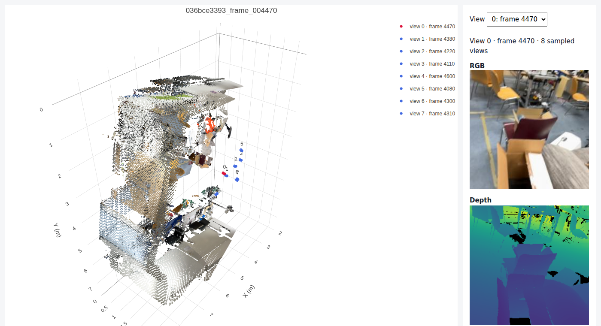

**Example 2**

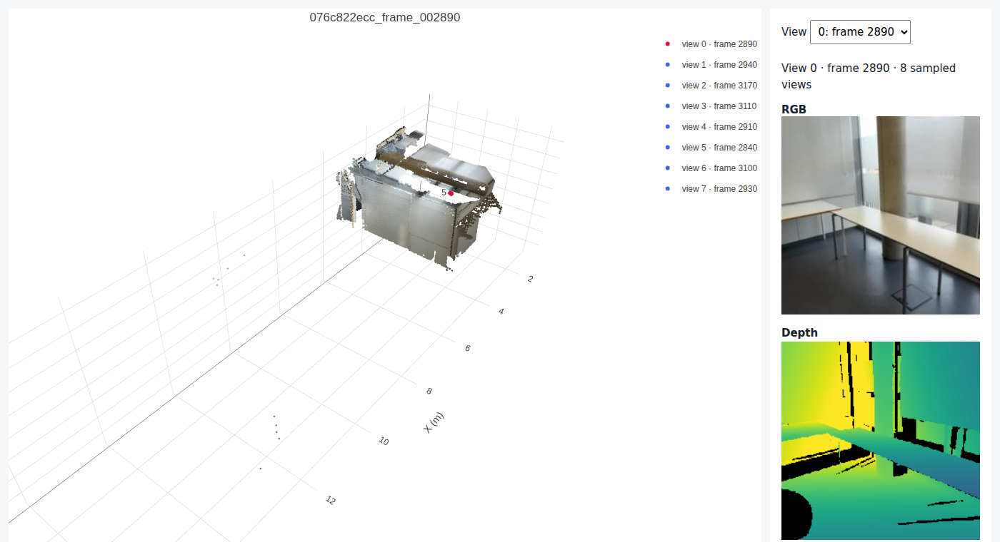

## Canonicalization

**Example 1.** First camera center: `(0, 0, 0)`; valid-point centroid distance: `1.000`.

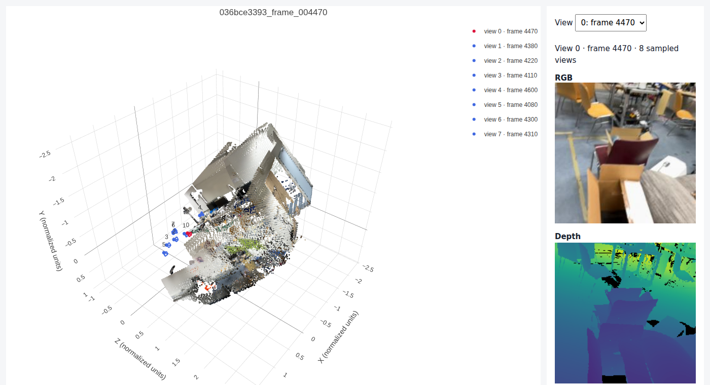

**Example 2.** First camera center: `(0, 0, 0)`; valid-point centroid distance: `1.000`.

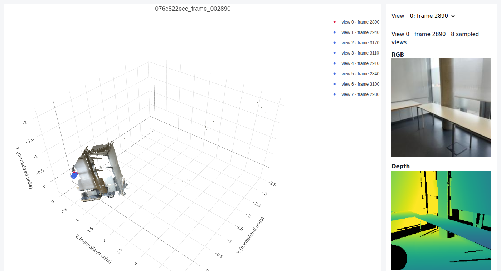

## `check_data.py`

```text
{"sequence_name": "e050c15a8d_frame_007080", "views": 8, "resolution": 224, "valid_depth_fraction": 0.9779127240180969, "max_reprojection_error_px": 0.00010844774078577757, "max_ray_reprojection_error_px": 9.41436446737498e-05, "centroid_distance": 1.0}
{"sequence_name": "5f99900f09_frame_002820", "views": 8, "resolution": 224, "valid_depth_fraction": 0.9903116226196289, "max_reprojection_error_px": 0.0001220703125, "max_ray_reprojection_error_px": 0.0001078959321603179, "centroid_distance": 1.0}
{"sequence_name": "47b37eb6f9_frame_002720", "views": 8, "resolution": 224, "valid_depth_fraction": 0.9609947800636292, "max_reprojection_error_px": 9.281559323426336e-05, "max_ray_reprojection_error_px": 8.446346328128129e-05, "centroid_distance": 1.0}
{"sequence_name": "4c5c60fa76_frame_006690", "views": 8, "resolution": 224, "valid_depth_fraction": 0.7516716122627258, "max_reprojection_error_px": 0.00010504279634915292, "max_ray_reprojection_error_px": 9.423537994734943e-05, "centroid_distance": 1.0}

rgb: (2, 8, 3, 224, 224)
depth: (2, 8, 1, 224, 224)
depth_valid: (2, 8, 1, 224, 224)
K: (2, 8, 3, 3)
frame_numbers: (2, 8)
T_world_from_camera: (2, 8, 4, 4)
original_world_from_reference: (2, 4, 4)
scene_scale: (2,)
points_world: (2, 8, 3, 224, 224)
ray_origins: (2, 8, 3, 224, 224)
ray_directions: (2, 8, 3, 224, 224)
plucker: (2, 8, 6, 224, 224)
```

Canonicalization expresses every view in camera 0's frame and scales the scene so the valid-point centroid is one unit away. World-space ray directions are normalized pixel rays transformed by the camera rotation. Plücker rays are `(d, o × d)`.

# 2. Novel-View Synthesis with Mini-LVSM

## 2.1 Overfitting

Final overfit PSNR: **30.92 dB** after 2,000 steps on one batch.

Panels are arranged left to right as **source view(s)**, **ground truth**, and **prediction**.

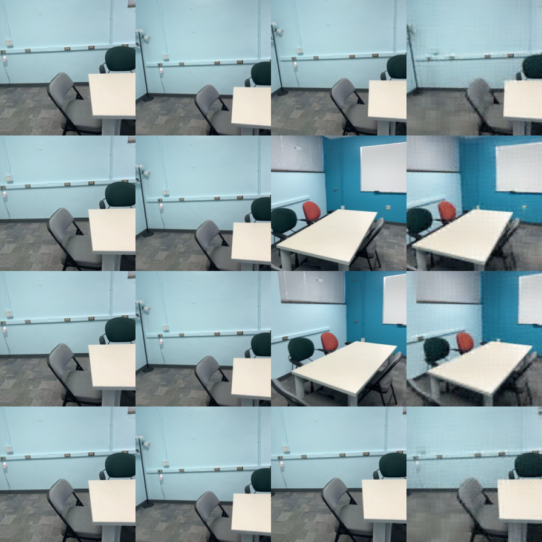

## 2.2 Training and evaluation

**Training settings:** 2 source and 6 target views, 224px images, batch size 4, patch size 8, width 384, 8 blocks, head dimension 64, and bfloat16 autocast. AdamW used `lr=2e-4`, weight decay `0.05`, 200 warmup steps, and cosine decay for 100 epochs (5,600 steps).

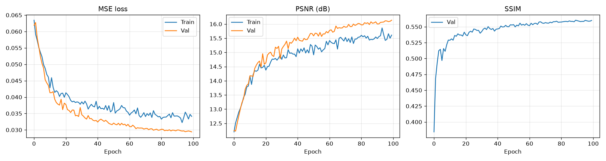

**Training visualization (epoch 95).** Panels are arranged left to right as **source views**, **ground truth**, and **prediction**.

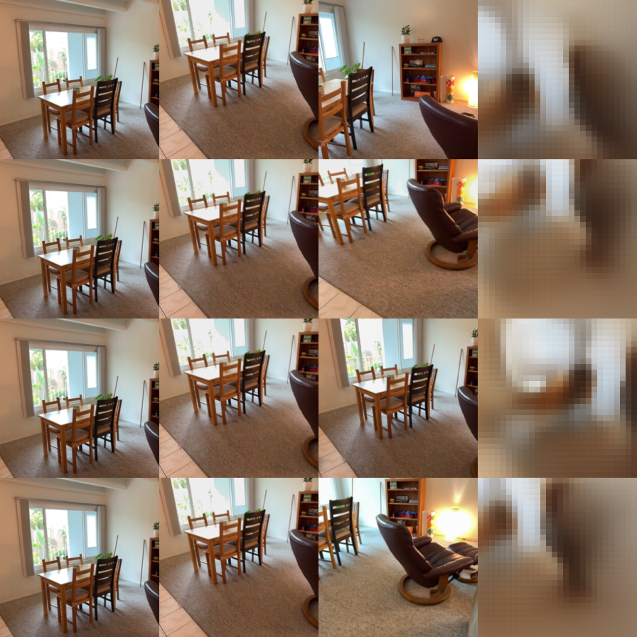

**Validation metrics (`best.pt`)**

| Source views | Conditioning | PSNR | SSIM |
|---:|---|---:|---:|
| 1 | Correct rays | 15.19 | 0.5579 |
| 1 | Shuffled rays | 11.80 | 0.4871 |
| 1 | No rays | 12.48 | 0.5300 |
| 2 | Correct rays | 16.13 | 0.5599 |
| 2 | Shuffled rays | 11.50 | 0.4719 |
| 2 | No rays | 12.45 | 0.5276 |
| 4 | Correct rays | 16.88 | 0.5753 |
| 4 | Shuffled rays | 11.59 | 0.4728 |
| 4 | No rays | 12.47 | 0.5364 |

**Evaluation visualizations.** Each image is ordered left to right as **source view(s)**, **ground truth**, and **prediction**.

### 1 source view, correct rays

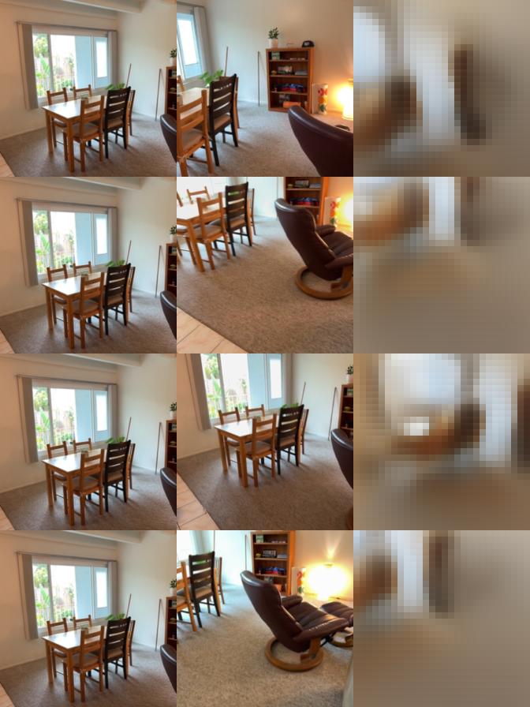

### 2 source views, correct rays


### 4 source views, correct rays

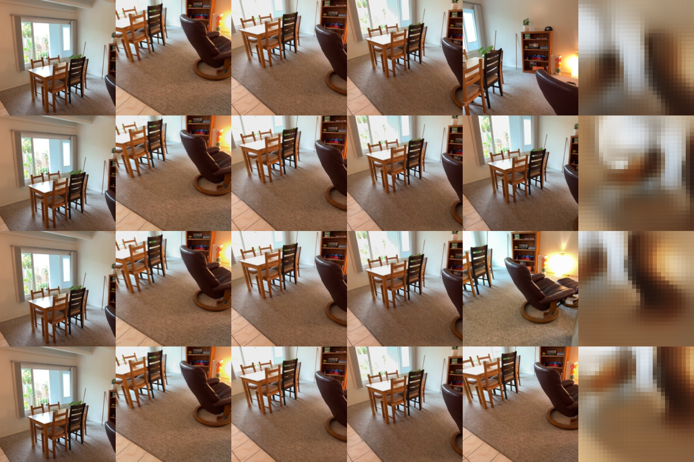

### 2 source views, shuffled rays

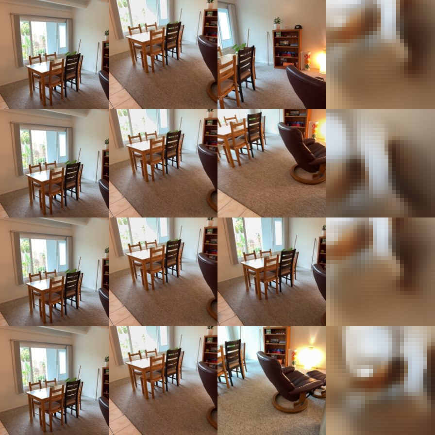

### 2 source views, no rays

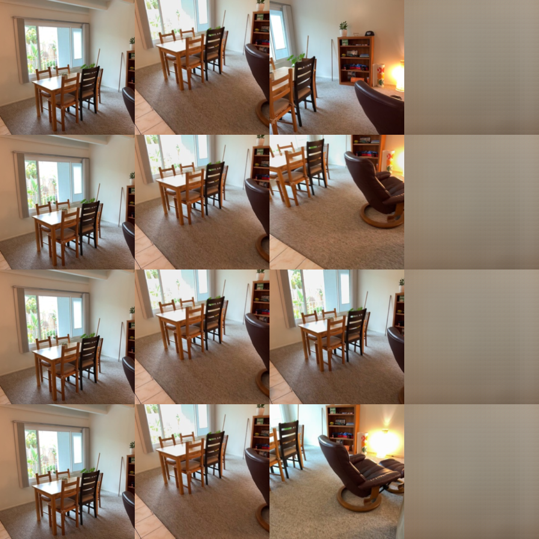

More source views improve performance with correct rays: PSNR rises from 15.19 (1 view) to 16.88 dB (4 views). Shuffled or zero target rays reduce PSNR by 2.7–5.3 dB, showing that the model uses the target-ray conditioning.

## 2.3 Bonus: Analysis and exploration

**Question:** Does training with more source views change quality when evaluating with 1, 2 and 4 source views?

**Settings:** Two runs with the same budget, 30 epochs (1,680 steps), everything else as in 2.2. One trains with S=2 sources (6 targets), the other with S=4 sources (4 targets). Both are evaluated on validation with correct rays.

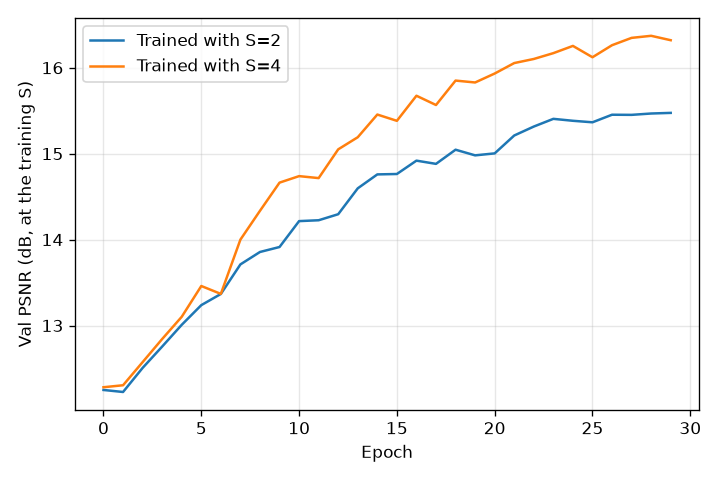

| Eval source views | Trained S=2: PSNR / SSIM | Trained S=4: PSNR / SSIM |
|---|---|---|
| 1 | 14.78 / 0.5486 | 14.77 / 0.5441 |
| 2 | 15.47 / 0.5484 | 15.63 / 0.5456 |
| 4 | 15.91 / 0.5612 | 16.37 / 0.5601 |

**Results:** Training with 4 sources is as good with 1 source view (14.78 vs 14.77 dB) and better with 2 (+0.16 dB) and 4 (+0.46 dB). SSIM is about the same.

**Conclusion:** Training with more sources helps most when evaluating with many sources, and does not hurt with one. A likely reason is that S=4 training practices combining more source views, which is what evaluation with 2 and 4 sources needs.

**Limitations:** One seed and a short 30-epoch schedule; the differences are below 0.5 dB, so they may change with longer training.

# 3. Multi-View Geometry with Mini-VGGT

## 3.1 Overfitting

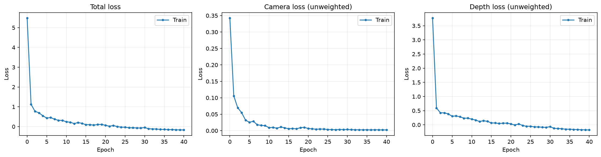

| Ground truth | Prediction |
|---|---|
|  | 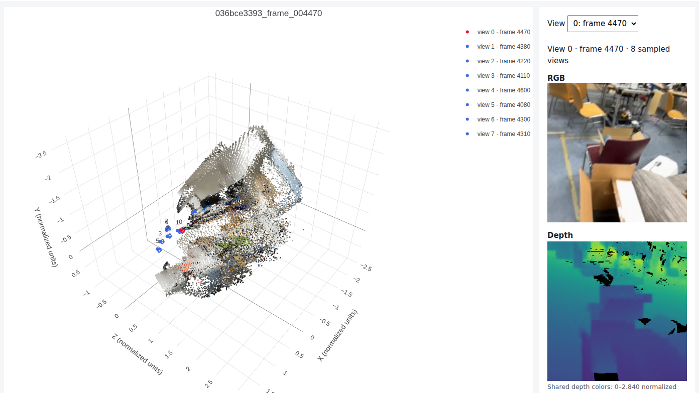 |

## 3.2 Training and evaluation

**Training settings:** frozen DINOv2 ViT-B/14, 8 frame/global block pairs (width 384, 6 heads), 8 views from a 32-frame window, 224px images, and batch size 16. AdamW used `lr=6e-4`, weight decay `0.01`, 10 warmup epochs, and cosine decay; camera/depth loss weights were 5/1. Training ran for 1,000 epochs (14,000 steps); `best.pt` is from epoch 788.

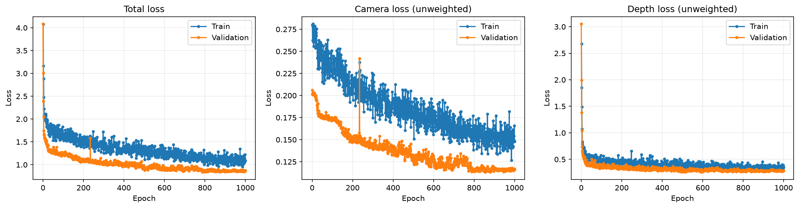

**Metrics (`best.pt`):** 8 views sampled from the first 32 prepared frames at 224px with seed 825.

| Metric | Validation | Test |
|---|---:|---:|
| Depth AbsRel | 0.1413 | 0.1566 |
| Depth δ1 | 0.8316 | 0.8022 |
| Rotation AUC@5 | 0.2099 | 0.1959 |
| Rotation AUC@15 | 0.5154 | 0.5064 |
| Rotation AUC@30 | 0.6924 | 0.7099 |
| Translation AUC@5 | 0.0184 | 0.0079 |
| Translation AUC@15 | 0.0841 | 0.0416 |
| Translation AUC@30 | 0.1985 | 0.1356 |
| Joint pose AUC@5 | 0.0038 | 0.0031 |
| Joint pose AUC@15 | 0.0637 | 0.0305 |
| Joint pose AUC@30 | 0.1734 | 0.1226 |

### Validation scene 1

| Ground truth | Prediction |
|---|---|
| 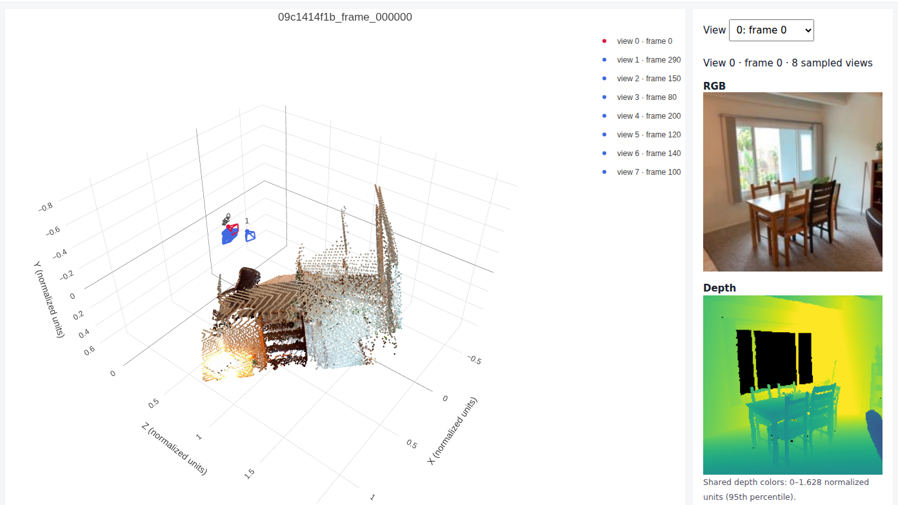 | 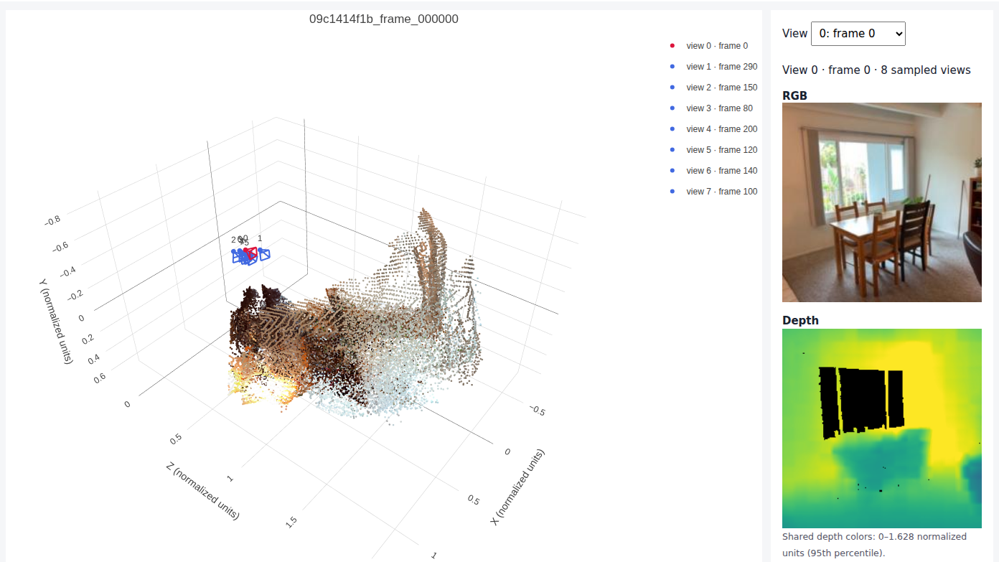 |

### Validation scene 2

| Ground truth | Prediction |
|---|---|
| 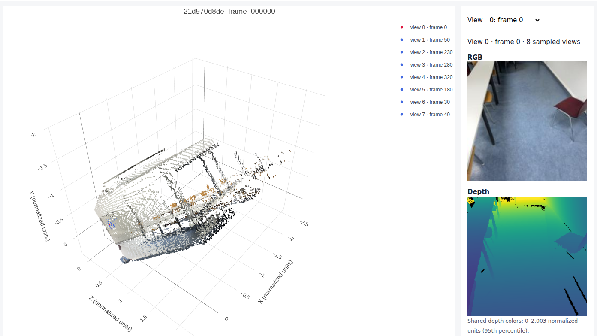 | 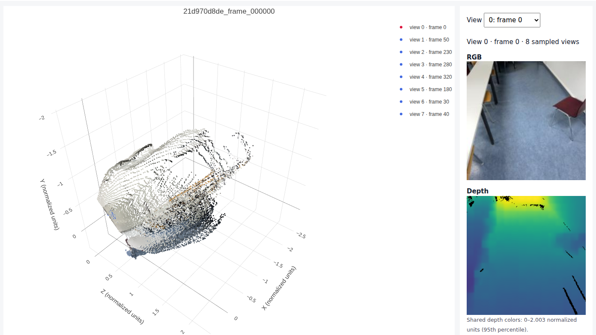 |

### Validation scene 3

| Ground truth | Prediction |
|---|---|
| 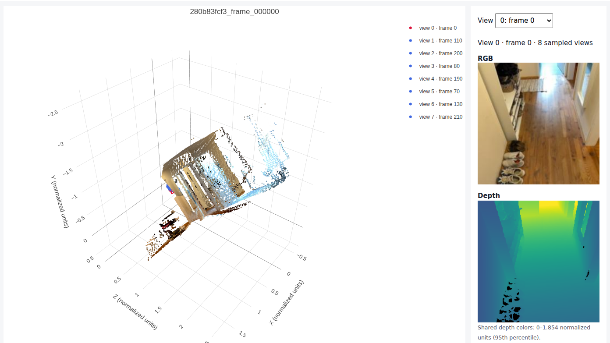 | 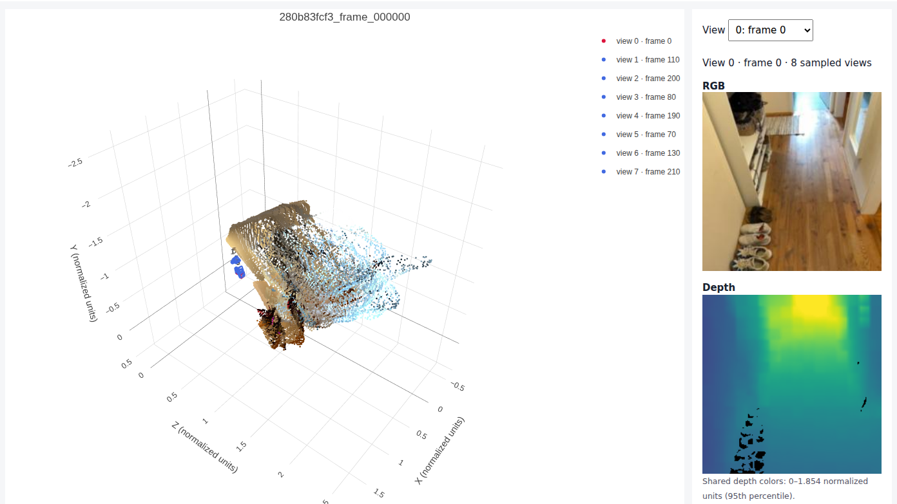 |

### Validation scene 4

| Ground truth | Prediction |
|---|---|
| 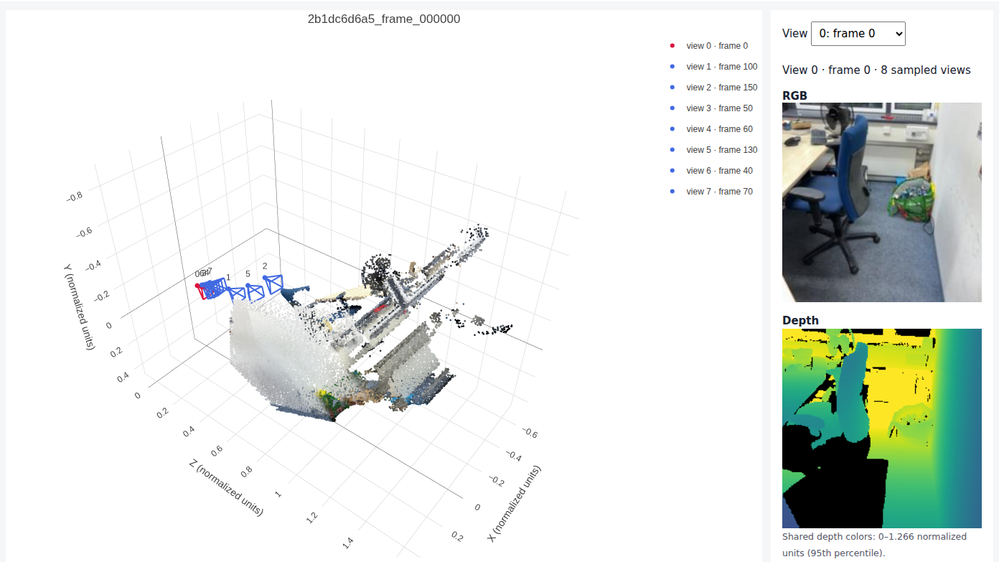 | 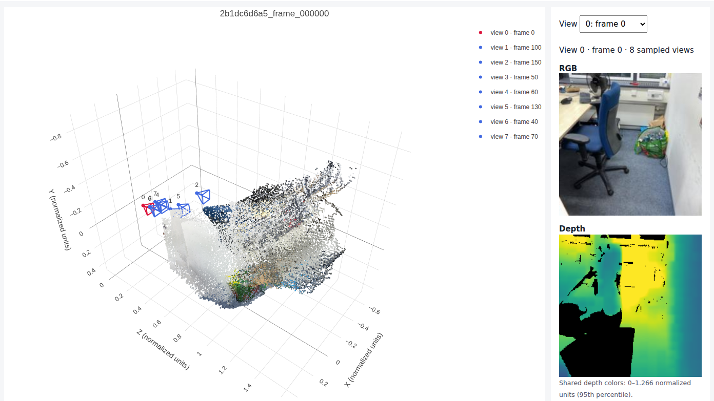 |

Depth generalizes reasonably well, but camera translation is the main failure mode. Translation errors misalign points across views, and predicted depth is smoother than ground truth, especially on thin structures.

## 3.3 Bonus: Analysis and exploration

**Question:** How does the number of input views at evaluation affect accuracy, runtime and memory?

**Settings:** The trained `best.pt` from 3.2 (trained with 8 views) is evaluated on validation with 2, 4, 8, 16 and 32 views from the first 32 prepared frames (224px, seed 825). Runtime and peak memory are for one forward pass on one sample (bf16, H100, mean of 10 runs).

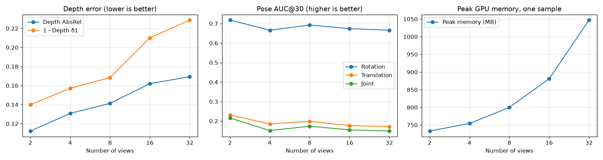

| Views | Depth AbsRel | Depth δ1 | Rotation AUC@30 | Translation AUC@30 | Joint AUC@30 | Forward (ms) | Peak memory (MB) |
|---|---|---|---|---|---|---|---|
| 2 | 0.1122 | 0.8601 | 0.7179 | 0.2310 | 0.2155 | 20.3 | 733 |
| 4 | 0.1308 | 0.8429 | 0.6659 | 0.1847 | 0.1510 | 20.4 | 755 |
| 8 | 0.1413 | 0.8316 | 0.6924 | 0.1985 | 0.1734 | 20.7 | 800 |
| 16 | 0.1620 | 0.7899 | 0.6740 | 0.1762 | 0.1545 | 20.0 | 881 |
| 32 | 0.1693 | 0.7712 | 0.6656 | 0.1716 | 0.1485 | 23.4 | 1047 |

**Results:** Depth error grows steadily with more views (AbsRel 0.112 at 2 views to 0.169 at 32). Pose AUC is best with 2 views and roughly flat from 4 to 32. Memory grows with the number of views (733 to 1047 MB), faster at higher counts because global attention covers all tokens of all views. Runtime stays about 20–23 ms, since one sample is too small to fill the GPU.

**Conclusion:** More views do not improve this model. It was trained with 8 views, so 16 and 32 are outside its training setting.

**Limitations:** The pose metrics average over a different number of view pairs (1 pair at 2 views, 496 at 32), so the views compared are not the same across rows. Only one trained model was tested; training with more views was not tried.
