# 16-825 Assignment 5

**Andrew ID:** sbandred

**Name:** Sri Datta Bandreddi

# 1. Classification Model

Test accuracy: **97.48%**

**Random test objects**

|  |  | 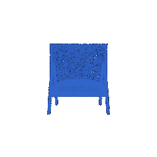 |
|---|---|---|
| GT chair, predicted **chair** | GT chair, predicted **chair** | GT chair, predicted **chair** |
| 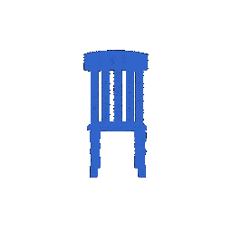 | 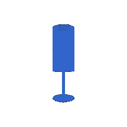 | 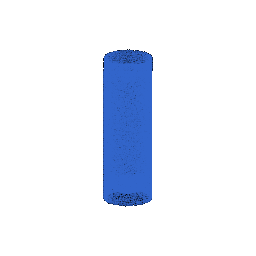 |
| GT chair, predicted **chair** | GT lamp, predicted **lamp** | GT vase, predicted **vase** |

**Failures**

|  |  |  |
|---|---|---|
| GT chair, predicted **lamp** | GT vase, predicted **lamp** | GT lamp, predicted **vase** |

**Interpretation:** The only misclassified chair has a tall rounded back on a narrow frame, which looks like a lampshade on a stand. The vase sits on a tall pedestal, so its outline is a base with a wider part on top, like a lamp. The lamp is a closed column with no visible shade or stand, which is the typical vase shape. Most errors are between vases and lamps, which share tall rotationally symmetric shapes and have the fewest training examples (741 vases and 1,554 lamps against 4,489 chairs).

# 2. Segmentation Model

Test accuracy: **90.49%**

| Object | Ground truth | Prediction | Accuracy |
|---|---|---|---|
| 9 |  | 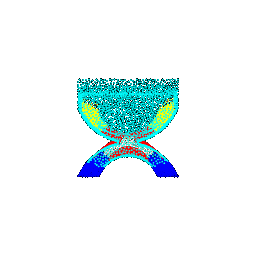 | 68.86% |
| 442 |  | 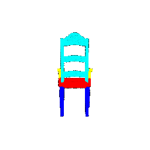 | 93.83% |
| 567 |  |  | 79.76% |
| 235 (bad) | 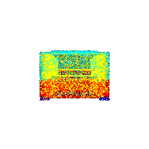 | 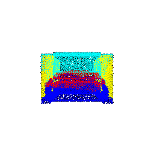 | 41.71% |
| 351 (bad) | 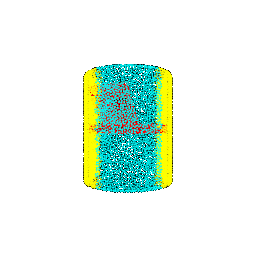 | 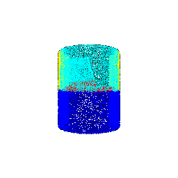 | 47.44% |

**Interpretation:** Chairs with clearly separated parts, like 442, are segmented well, and most errors sit on the boundaries between parts (seat and back, seat and armrests). The two bad cases are closed, box-like chairs. In 235 the seat and the base form one solid block, and in 351 a barrel chair has no visible legs, yet the model still labels the bottom as legs because almost every training chair has them. PointNet labels each point from its own coordinates plus one global feature, so it relies on where a point usually is on a chair rather than on local geometry.

# 3. Robustness Analysis

## 3.1 Rotation

**Procedure:** Every test point cloud is rotated about the z axis (the viewing axis), which tilts the upright objects, by 0° to 180°. The models are the ones from Q1 and Q2 and were trained without rotation augmentation.

| Rotation | Classification accuracy | Segmentation accuracy |
|---|---|---|
| 0° (Q1, Q2) | 97.48% | 90.49% |
| 15° | 93.70% | 83.57% |
| 30° | 66.95% | 70.90% |
| 45° | 32.74% | 61.94% |
| 60° | 26.44% | 55.78% |
| 90° | 25.18% | 46.65% |
| 180° | 65.27% | 36.91% |

**Classification at 45°**

|  |  |  |
|---|---|---|
| GT chair, predicted **lamp** (Q1: chair) | GT lamp, predicted **vase** (Q1: lamp) | GT vase, predicted **lamp** (Q1: vase) |

**Segmentation at 45°**

| Object | Ground truth | Prediction | Accuracy (Q2) |
|---|---|---|---|
| 9 |  |  | 47.39% (68.86%) |
| 442 | 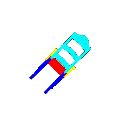 |  | 67.79% (93.83%) |
| 567 |  |  | 40.40% (79.76%) |

**Interpretation:** PointNet works on raw xyz coordinates and all training objects are upright, so it is not rotation invariant. Small tilts are tolerated, but from 30° onwards accuracy collapses and classification falls to chance (most objects are called vase or lamp). Segmentation degrades smoothly, because the predicted labels follow the original vertical bands: in the rotated chairs the seat and leg labels are assigned by height in the world frame, not along the tilted chair. At 180° classification partly recovers, since an upside-down chair still has a chair-like silhouette, while segmentation is worst because every part is at the wrong height.

## 3.2 Number of points

**Procedure:** Each test object is randomly subsampled from 10,000 points to fewer points (same subset for all objects), using `--num_points`. The models are the ones from Q1 and Q2, trained with 10,000 points.

| Points per object | Classification accuracy | Segmentation accuracy |
|---|---|---|
| 10,000 (Q1, Q2) | 97.48% | 90.49% |
| 5,000 | 97.38% | 90.49% |
| 1,000 | 96.85% | 90.10% |
| 500 | 96.43% | 89.06% |
| 100 | 88.98% | 81.16% |
| 50 | 72.72% | 77.12% |
| 10 | 26.13% | 66.58% |

**Classification with 100 points**

| 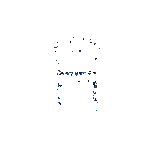 | 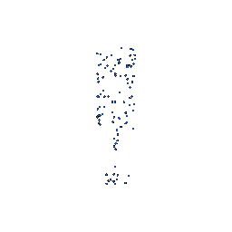 | 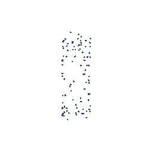 |
|---|---|---|
| GT chair, predicted **chair** (Q1: chair) | GT lamp, predicted **lamp** (Q1: lamp) | GT vase, predicted **lamp** (Q1: vase) |

**Segmentation with 100 points**

| Object | Ground truth | Prediction | Accuracy (Q2) |
|---|---|---|---|
| 9 | 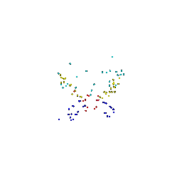 |  | 72.00% (68.86%) |
| 442 | 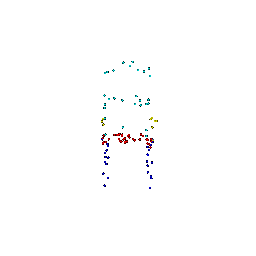 | 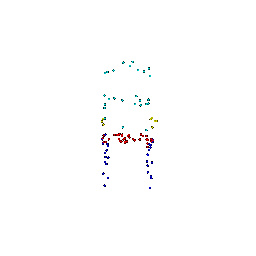 | 93.00% (93.83%) |
| 567 |  |  | 68.00% (79.76%) |

**Interpretation:** PointNet is very robust to sparser inputs. Accuracy barely changes down to 500 points (5% of the input) because the max pool only needs a few points near each extreme of the shape to produce nearly the same global feature. Below about 100 points the outline of thin parts, like legs and lamp stands, is lost and accuracy drops quickly. Segmentation degrades more slowly than classification, since each point is still labelled from its own position, which alone already predicts the part well (66.58% with only 10 points).

# 4. Locality: PointNet++

**Model:** PointNet++ with single-scale grouping (`cls_pp_model` and `seg_pp_model` in `models.py`). Each set abstraction layer picks centroids with farthest point sampling, groups the neighbors inside a ball around each centroid, and runs a small PointNet on their coordinates relative to the centroid, so features describe local regions instead of single points. Three layers are stacked: 512 centroids (radius 0.2, 32 neighbors), 128 centroids (radius 0.4, 64 neighbors), then one global region, which gives a 1024-d feature for the same classification head as Q1. For segmentation, three feature propagation layers interpolate features back to the denser levels (inverse-distance weights over the 3 nearest points) and concatenate the skip features, then a per-point head predicts the labels. Training uses the same settings as Q1 and Q2, with the point order shuffled in every batch.

| Task | PointNet (Q1, Q2) | PointNet++ |
|---|---|---|
| Classification | 97.48% | **98.32%** |
| Segmentation | 90.49% | **91.49%** |

**Classification (Q1 failures)**

|  |  |  |
|---|---|---|
| GT chair. PointNet: **lamp**, PointNet++: **lamp** | GT vase. PointNet: **lamp**, PointNet++: **lamp** | GT lamp. PointNet: **vase**, PointNet++: **lamp** |

**Segmentation**

| Object | Ground truth | PointNet | PointNet++ |
|---|---|---|---|
| 9 |  |  68.86% |  81.44% |
| 442 |  |  93.83% | 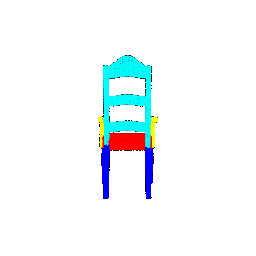 95.61% |
| 567 |  |  79.76% |  76.67% |
| 235 |  |  41.71% | 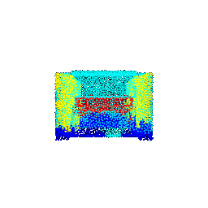 46.34% |
| 351 |  |  47.44% |  49.51% |

PointNet++ makes 16 classification errors instead of 24 and corrects the column lamp. In segmentation, local features give cleaner part boundaries: the base of chair 9 is labelled as legs and the seat is a thin layer, instead of a thick band of seat labels. The barrel chair (351) is still wrong, because its bottom has no local shape that separates it from legs.
