# 16-825 Assignment 5

**Andrew ID:** sbandred

**Name:** Sri Datta Bandreddi

# 1. Classification Model

Test accuracy: **97.48%**

**Random test objects**

| 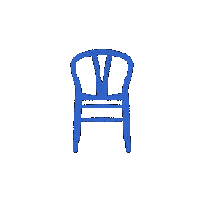 | 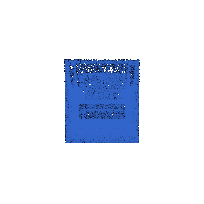 |  |
|---|---|---|
| GT chair, predicted **chair** | GT chair, predicted **chair** | GT chair, predicted **chair** |
|  |  |  |
| GT chair, predicted **chair** | GT lamp, predicted **lamp** | GT vase, predicted **vase** |

**Failures**

|  |  |  |
|---|---|---|
| GT chair, predicted **lamp** | GT vase, predicted **lamp** | GT lamp, predicted **vase** |

**Interpretation:** The chair has a tall rounded back on a narrow frame, which looks like a lamp shade on a stand. The vase sits on a tall pedestal, so it has a base with a wider part on top, like a lamp. The lamp is a closed column with no shade or stand, which looks like a vase. 23 of the 24 errors involve a vase or a lamp. These two classes have similar tall, round shapes and fewer training examples (741 vases and 1,554 lamps, against 4,489 chairs).

# 2. Segmentation Model

Test accuracy: **90.49%**

| Object | Ground truth | Prediction | Accuracy |
|---|---|---|---|
| 9 | 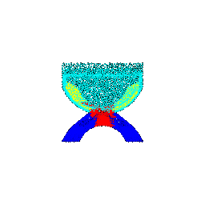 |  | 68.86% |
| 442 | 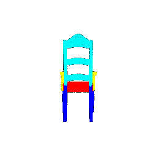 |  | 93.83% |
| 567 | 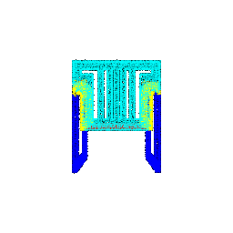 | 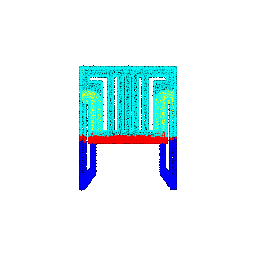 | 79.76% |
| 235 (bad) |  |  | 41.71% |
| 351 (bad) |  |  | 47.44% |

**Interpretation:** Chairs with clearly separated parts, like 442, are segmented well. Most errors are on the boundaries between parts, such as seat and back or seat and armrests. The two bad cases are closed, box-like chairs. In 235 the seat and the base form one solid block. In 351 the chair has no legs, but the model labels the bottom as legs because almost every training chair has them. PointNet labels each point from its position and one global feature, so it predicts where a part usually is, not what the local shape is.

# 3. Robustness Analysis

## 3.1 Rotation

**Procedure:** I rotate every test point cloud about the z axis by 0° to 180°, which tilts the upright objects. I evaluate the Q1 and Q2 models, which were trained without rotation augmentation.

| Rotation | Classification accuracy | Segmentation accuracy |
|---|---|---|
| 0° (Q1, Q2) | 97.48% | 90.49% |
| 15° | 93.70% | 83.57% |
| 30° | 66.95% | 70.90% |
| 45° | 32.74% | 61.94% |
| 60° | 26.44% | 55.78% |
| 90° | 25.18% | 46.65% |
| 180° | 65.27% | 36.91% |

**Classification at 45°**

|  | 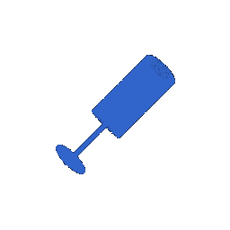 | 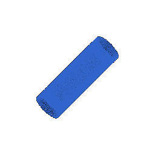 |
|---|---|---|
| GT chair, predicted **lamp** (Q1: chair) | GT lamp, predicted **vase** (Q1: lamp) | GT vase, predicted **lamp** (Q1: vase) |

**Segmentation at 45°**

| Object | Q2 prediction | Ground truth (45°) | Prediction (45°) |
|---|---|---|---|
| 9 |  68.86% | 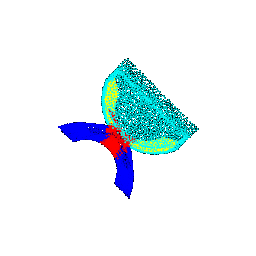 | 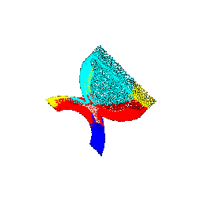 47.39% |
| 442 |  93.83% |  | 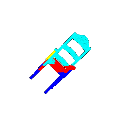 67.79% |
| 567 |  79.76% | 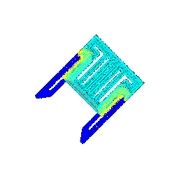 | 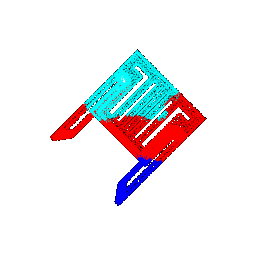 40.40% |

**Interpretation:** PointNet uses raw xyz coordinates and every training object is upright, so it is not rotation invariant. A 15° tilt lowers accuracy by 4 to 7 points. From 30° on, accuracy drops sharply, and classification reaches chance level (about 33%) at 45°. In segmentation the predicted labels follow height in the world frame instead of the tilted chair, as the 45° examples show. At 180° classification partly recovers, since an upside-down chair still has a chair-like outline. Segmentation is worst at 180° because every part is at the wrong height.

## 3.2 Number of points

**Procedure:** I randomly subsample each test object from 10,000 points down to 10 points with `--num_points`, using the same point indices for every object. I evaluate the Q1 and Q2 models, which were trained with 10,000 points.

| Points per object | Classification accuracy | Segmentation accuracy |
|---|---|---|
| 10,000 (Q1, Q2) | 97.48% | 90.49% |
| 5,000 | 97.38% | 90.49% |
| 1,000 | 96.85% | 90.10% |
| 500 | 96.43% | 89.06% |
| 100 | 88.98% | 81.16% |
| 50 | 72.72% | 77.12% |
| 10 | 26.13% | 66.58% |

**Classification with 100 points**

|  |  |  |
|---|---|---|
| GT chair, predicted **chair** (Q1: chair) | GT lamp, predicted **lamp** (Q1: lamp) | GT vase, predicted **lamp** (Q1: vase) |

**Segmentation with 100 points**

| Object | Q2 prediction | Ground truth (100 points) | Prediction (100 points) |
|---|---|---|---|
| 9 |  68.86% |  | 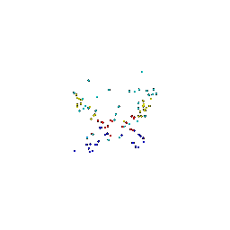 72.00% |
| 442 |  93.83% |  |  93.00% |
| 567 |  79.76% | 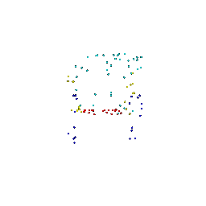 | 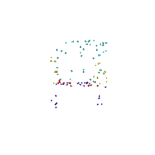 68.00% |

**Interpretation:** PointNet is robust to fewer points. Down to 500 points (5% of the input), accuracy drops by at most 1.4 points. The max pool needs only a few points from each part of the shape to produce almost the same global feature. At 100 points and below, thin parts like legs and lamp stands are barely sampled, and accuracy drops quickly. At 50 and 10 points segmentation holds up better than classification, because a point's position alone is a strong cue for its part (66.58% with 10 points).

# 4. Locality: PointNet++

**Model:** PointNet++ with single-scale grouping (`cls_pp_model` and `seg_pp_model` in `models.py`). Each set abstraction layer picks centroids with farthest point sampling, groups the points within a radius of each centroid, and runs a small PointNet on their coordinates relative to the centroid. This gives features for local regions instead of single points. There are three layers: 512 centroids (radius 0.2, 32 neighbors), 128 centroids (radius 0.4, 64 neighbors), and one global region. The result is a 1024-d feature, used with the same classification head as Q1. For segmentation, three feature propagation layers interpolate the features back to the denser levels, using inverse-distance weights over the 3 nearest points. Each layer concatenates skip features, and a per-point head predicts the labels. Training uses the same settings as Q1 and Q2, with the point order shuffled in every batch.

| Task | PointNet (Q1, Q2) | PointNet++ |
|---|---|---|
| Classification | 97.48% | **98.32%** |
| Segmentation | 90.49% | **91.49%** |

**Classification (Q1 failures)**

|  |  |  |
|---|---|---|
| GT chair. PointNet: **lamp**, PointNet++: **lamp** | GT vase. PointNet: **lamp**, PointNet++: **lamp** | GT lamp. PointNet: **vase**, PointNet++: **lamp** |

**Segmentation**

| Object | Ground truth | PointNet | PointNet++ |
|---|---|---|---|
| 9 |  |  68.86% | 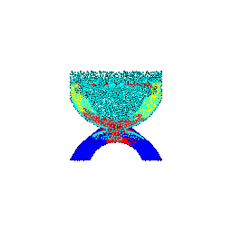 81.44% |
| 442 |  |  93.83% |  95.61% |
| 567 |  |  79.76% | 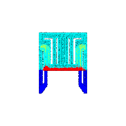 76.67% |
| 235 |  |  41.71% |  46.34% |
| 351 |  |  47.44% | 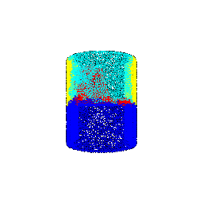 49.51% |

PointNet++ makes 16 classification errors instead of 24 and classifies the column lamp correctly. In segmentation, local features give cleaner part boundaries. In chair 9 the base is labelled as legs and the seat is a thin layer, instead of a thick band of seat labels. Chair 351 is still wrong, because its bottom has no local shape that separates it from legs.

# References

1. C. R. Qi, H. Su, K. Mo, L. J. Guibas. PointNet: Deep Learning on Point Sets for 3D Classification and Segmentation. CVPR 2017. [arXiv:1612.00593](https://arxiv.org/abs/1612.00593), code: [charlesq34/pointnet](https://github.com/charlesq34/pointnet)
2. C. R. Qi, L. Yi, H. Su, L. J. Guibas. PointNet++: Deep Hierarchical Feature Learning on Point Sets in a Metric Space. NeurIPS 2017. [arXiv:1706.02413](https://arxiv.org/abs/1706.02413), code: [charlesq34/pointnet2](https://github.com/charlesq34/pointnet2)
3. N. Ravi, J. Reizenstein, D. Novotny, T. Gordon, W.-Y. Lo, J. Johnson, G. Gkioxari. Accelerating 3D Deep Learning with PyTorch3D. arXiv 2020. [arXiv:2007.08501](https://arxiv.org/abs/2007.08501), code: [facebookresearch/pytorch3d](https://github.com/facebookresearch/pytorch3d) (farthest point sampling, ball query and kNN ops)
4. Course starter code: [learning3d/assignment5](https://github.com/learning3d/assignment5)
